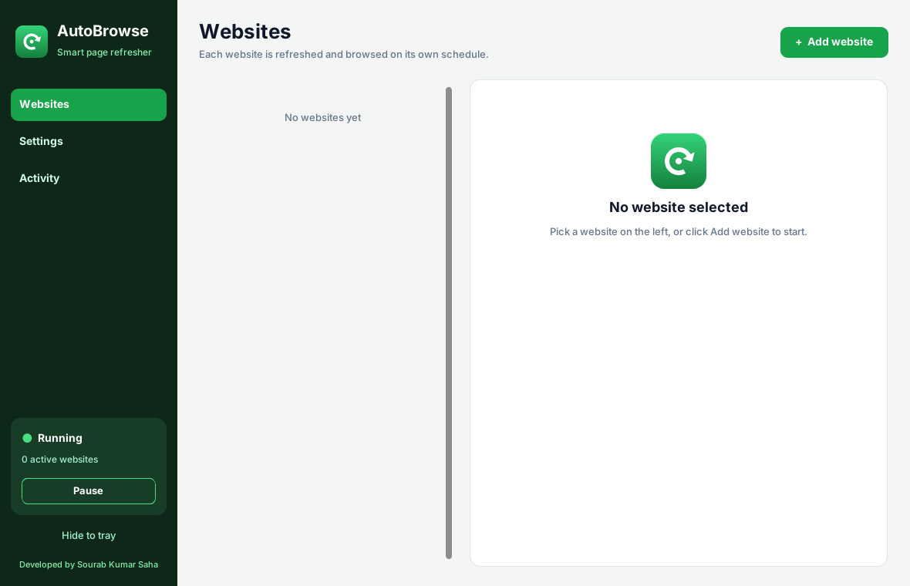
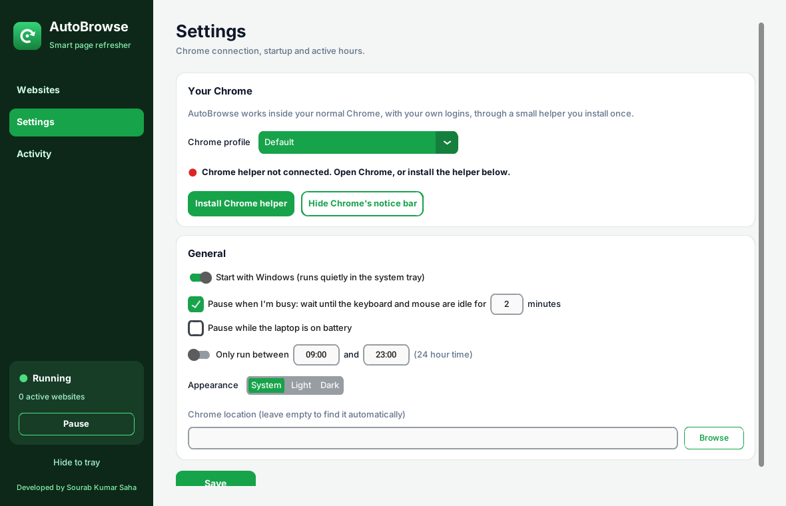
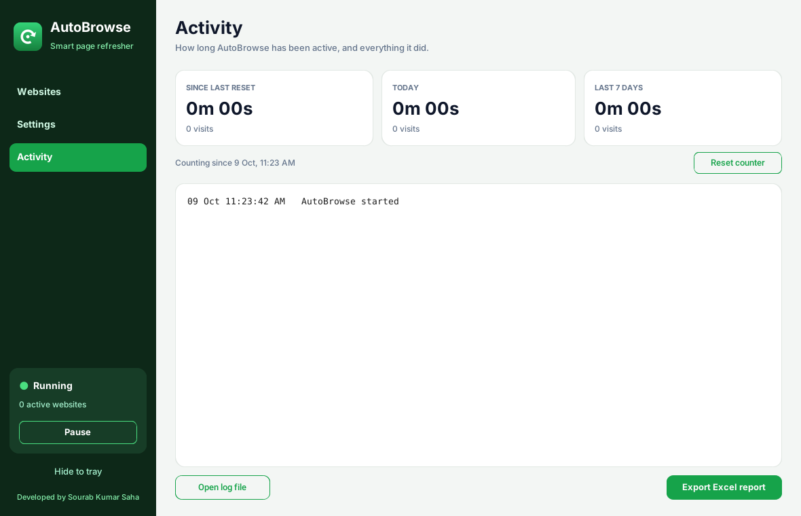

# AutoBrowse

A Windows system tray app that keeps your chosen websites open and fresh in your own Chrome. It refreshes each site on a fixed or random schedule, opens inner pages, scrolls and reads like a normal visit, and alerts you when a page changes, logs you out or goes down.

Developed by Sourab Kumar Saha.

## Features

| Feature | Details |
|---|---|
| Per-site schedules | Refresh every X minutes, or at a random time between X and Y minutes |
| Natural browsing | Opens 1 to N inner pages per visit, scrolls, pauses to read, returns to the main page |
| Pages to click | Pick link names or paths to visit, or let it choose any page on the site |
| Safe by default | Never clicks links such as logout, delete, unsubscribe, cart, checkout or payment |
| Alerts | Notifies you when a page changes, you get logged out, or the site is down |
| Works with your logins | Runs inside your normal Chrome profile through a small helper extension |
| Polite to you | Pauses while you are using the keyboard or mouse, on battery, or outside your active hours |
| Activity | Active time today, this week and since reset, a full log, and an Excel report export |
| Tray app | Starts with Windows, runs quietly in the tray, with Visit all now, Pause and Exit |

## Screenshots

| Settings | Activity |
|---|---|
|  |  |

## Install

1. Install Python 3.10 or newer.
2. Double-click **Setup.bat**. It installs the libraries, builds AutoBrowse.exe, adds Desktop and Start Menu shortcuts and starts the app.

You can also run **AutoBrowse.pyw** directly; it installs any missing library on first start.

## One-time Chrome setup

1. Open Settings and pick the Chrome profile where your websites are logged in.
2. Click **Install Chrome helper**. In Chrome turn on Developer mode, click Load unpacked and select the folder path AutoBrowse copied for you.
3. The status turns green: Chrome helper connected.

See How to use.txt for the full guide.

## Tech stack

Python, CustomTkinter, pystray, websockets, Pillow, openpyxl, Chrome DevTools Protocol, PyInstaller.

## Author

Sourab Kumar Saha. Available for custom automation and desktop tools on [Fiverr](https://www.fiverr.com/spontaneoussrv) and [Upwork](https://www.upwork.com/freelancers/spontaneoussrv).
